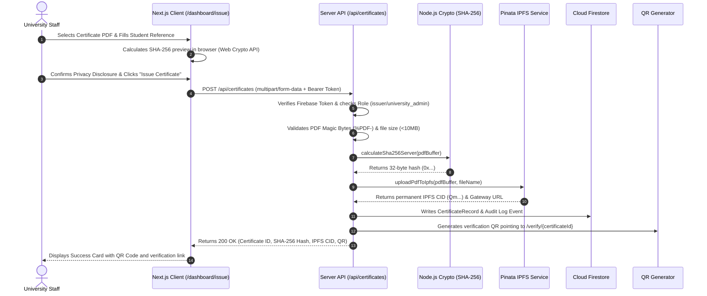
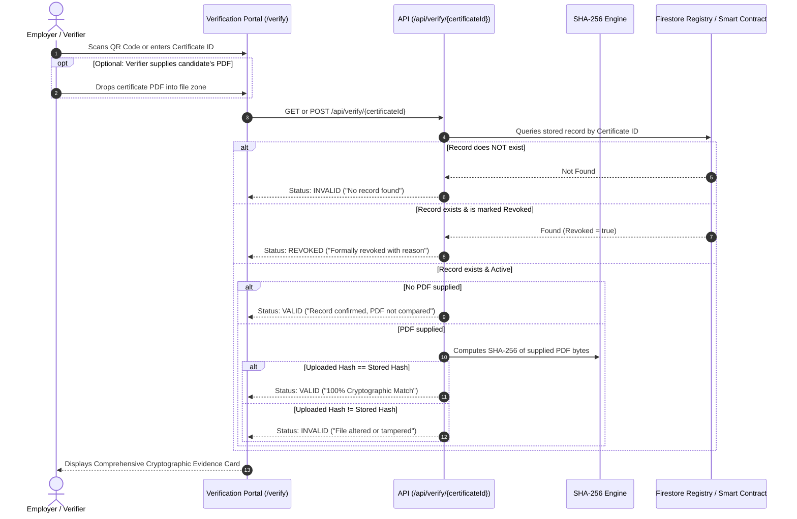
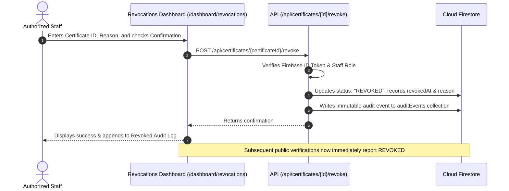

# MEMOCHECK System Architecture & Workflow Specification

This document outlines the complete end-to-end architectural workflows for **MEMOCHECK**: Credential Issuance, Verification, and Revocation.

---

## 1. High-Level System Architecture

```mermaid
graph TD
    subgraph Users ["Actors & Clients"]
        Staff["University Registrar / Issuer"]
        Student["Graduate / Credential Holder"]
        Verifier["Employer / Academic Verifier"]
    end

    subgraph App ["MEMOCHECK Application (Next.js 14)"]
        UI["Web Interface (Tailwind CSS)"]
        API["Serverless API Routes (/api/...)"]
        Hasher["SHA-256 Cryptographic Engine"]
    end

    subgraph Storage ["Distributed Infrastructure"]
        Auth["Firebase Authentication (Google)"]
        DB["Cloud Firestore (Metadata & Audit)"]
        IPFS["Pinata IPFS (Decentralized Storage)"]
        Chain["EVM Smart Contract (Optional Ledger)"]
    end

    Staff -->|1. Authenticates & Uploads PDF| UI
    UI -->|2. FormData (PDF + Metadata)| API
    API -->|3. Reads Raw Bytes| Hasher
    API -->|4. Uploads Document| IPFS
    API -->|5. Stores Record & Hash| DB
    API -.->|6. (Optional) Registers Hash| Chain
    API -->|7. Generates QR Code| UI

    Student -->|Presents PDF & QR Code| Verifier
    Verifier -->|Scans QR or Enters ID| UI
    Verifier -->|Uploads PDF for Byte Check| UI
    UI -->|Queries Verification API| API
    API -->|Compares Hashes| DB
    API -->|Returns Evidence & Status| UI
```

---

## 2. Certificate Issuance Workflow



### Detailed Issuance Steps
1. **Authentication & Authorization**: University staff signs in via Google OAuth. The server verifies that the caller has been granted the `university_admin` or `issuer` role.
2. **Byte-Level Fingerprinting**: The server reads the raw binary buffer of the uploaded PDF and computes its cryptographic SHA-256 digest (`crypto.createHash("sha256")`).
3. **Decentralized Anchoring**: The exact PDF bytes are uploaded to IPFS through Pinata's API, yielding a permanent, content-addressed Content Identifier (CID).
4. **Audit Trail**: Metadata (student ID ref, course, award, issue date), the SHA-256 hash, and the IPFS CID are persisted in Firestore along with an immutable audit event.
5. **QR Code Delivery**: A high-resolution QR code is generated for placement onto the official diploma or digital certificate.

---

## 3. Public Verification Workflow



### Verification Determination States

| Status | Color | Condition | Meaning |
| :--- | :--- | :--- | :--- |
| **`VALID`** | **Green** | Record found, Active, and PDF bytes match 100% | The certificate is authentic, untouched, and issued by the university. |
| **`INVALID`** | **Red** | Record not found OR PDF hash mismatches | The credential does not exist or the document was altered/forged. |
| **`REVOKED`** | **Amber** | Record found, but marked revoked | The degree was officially cancelled or superseded by the university. |
| **`UNABLE_TO_VERIFY`** | **Amber** | Network or database dependency unreachable | Verification could not complete. Never falsified as valid. |

---

## 4. Administrative Revocation Workflow



---

## 5. Security & Privacy Model

1. **Student Privacy Protection:**
   * Student Personal Identifiable Information (PII) such as personal emails, phone numbers, and home addresses are never published to public verification records.
   * Public verifiers see only institutional award information and cryptographic proof of authenticity.
2. **Avalanche Effect for Tamper Prevention:**
   * Any modification to a single character in the certificate changes the entire 64-character SHA-256 hash, causing instant detection during verification.
3. **Role-Based Server Authorization:**
   * Issuance and revocation APIs are secured server-side using Firebase Admin token verification. Client-side state alone can never authorize an issuance.
